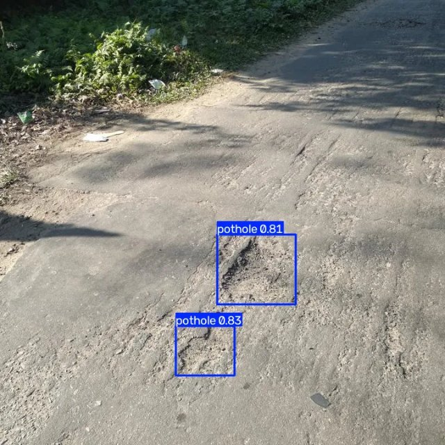
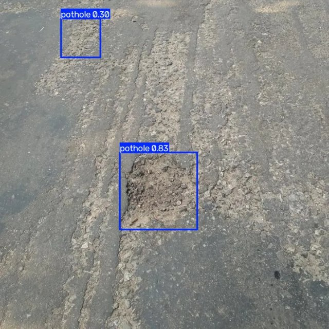
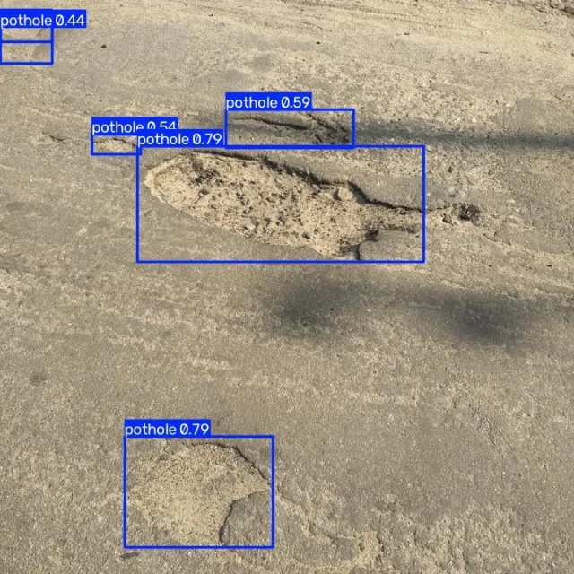
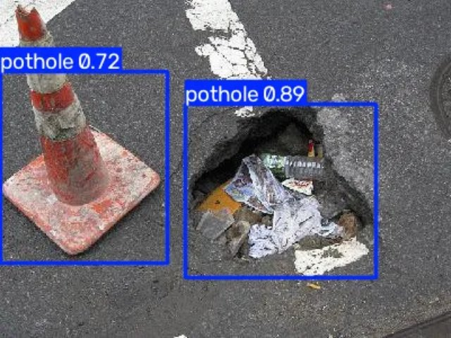

# Pothole Detection with YOLO11n

Detect potholes in road images with a fine-tuned YOLO11n model, plus a Gradio demo.

**Demo:** runs locally with one command (see [Quickstart](#quickstart)). There is no hosted demo, because Hugging Face now needs a paid plan to host Gradio Spaces.

**Model on Hugging Face:** [SPatel02/pothole-detection-yolo11](https://huggingface.co/SPatel02/pothole-detection-yolo11)

```python
from huggingface_hub import hf_hub_download
from ultralytics import YOLO

model = YOLO(hf_hub_download("SPatel02/pothole-detection-yolo11", "best.pt"))
model.predict("road.jpg", conf=0.25)[0].show()
```

## Why

Potholes damage vehicles, cause accidents and are especially dangerous for two-wheelers and cyclists. Many are reported late, or not at all. A small, fast detector that runs on ordinary road photos could help flag damaged road sections automatically, for example from dashcam footage, so repairs can be prioritised sooner.

This project fine-tunes the smallest YOLO11 model (2.6M parameters) on a public pothole dataset and wraps it in a simple web demo.

## Quickstart

```bash
pip install -r requirements.txt && python app.py
```

Then open http://127.0.0.1:7860, upload a road image and adjust the confidence slider. The model weights (`weights/best.pt`, 5.4 MB) are included in the repo.

## Sample outputs

Predictions from the demo at confidence 0.25 on held-out **test** images (not seen during training):

| | |
|---|---|
|  |  |
|  |  |

The bottom-right image shows a real failure: the traffic cone on the left is detected as a pothole (0.72), next to a correct detection (0.89).

## Results

YOLO11n fine-tuned for 30 epochs at 640 px (auto batch size = 11, seed 42), from [`results/metrics.json`](results/metrics.json):

| Split | Images | Precision | Recall | mAP50 | mAP50-95 |
|---|---|---|---|---|---|
| Validation | 133 | 0.807 | 0.673 | 0.762 | 0.473 |
| Test | 67 | 0.771 | 0.727 | 0.792 | 0.503 |

- **Inference speed:** 3.44 ms per image (plus 0.87 ms preprocess and 0.60 ms postprocess), averaged over 10 test images on an NVIDIA RTX 4060 Laptop GPU. CPU inference will be slower (not measured).
- **Training time:** about 1.7 minutes for 30 epochs on the same GPU.
- Full per-epoch log: [`results/results.csv`](results/results.csv). Training curves: [`results/results.png`](results/results.png). PR curve and confusion matrix are also in [`results/`](results/).

## Reproduce training

```bash
pip install -r requirements.txt
python download_data.py   # asks for a free Roboflow API key (hidden prompt, never saved)
python train.py           # trains, validates on val + test, writes results/ and weights/best.pt
```

## Dataset

[Pothole dataset, v1](https://universe.roboflow.com/brad-dwyer/pothole-voxrl/dataset/1) on Roboflow Universe: 665 road images with one class, `pothole` (465 train / 133 valid / 67 test, 1,740 boxes in total). Created by **Atikur Rahman Chitholian** as part of an undergraduate thesis and originally published on Kaggle; re-split 70/20/10 by Roboflow.

**License:** [Open Database License (ODbL) v1.0](https://opendatacommons.org/licenses/odbl/1-0/). The dataset is not included in this repo; `download_data.py` fetches it. The four sample images above are from the dataset's test split.

## Limitations

- **Small dataset.** Only 465 training images, so the model has seen a limited variety of roads, cameras and pothole types.
- **Small, distant potholes are hard.** About a third of the labelled boxes cover less than 1% of the image, and recall (0.67 on validation) shows many potholes are missed.
- **False positives** on round or dark objects, such as the traffic cone in the samples above.
- **Lighting and weather bias.** The images I checked are mostly daytime photos. Night, rain and wet-road performance has not been evaluated.
- **Mixed image sources.** Some training images are watermarked stock photos, which may not look like real dashcam footage.
- **Bounding boxes only.** The model does not estimate pothole size or depth.

## Next steps

- Train longer: validation mAP was still rising at epoch 30.
- Try a larger model (YOLO11s) and compare the speed vs. accuracy trade-off.
- Add more varied data, especially night, rain and dashcam images, and evaluate on them separately.
- Add negative examples (cones, manholes, shadows, patches) to reduce false positives.
- Run on video and export to ONNX for faster CPU inference.
- Host a public demo (a Gradio Space on a paid Hugging Face plan, or an in-browser ONNX version).

## License

- Code in this repo: MIT, see [LICENSE](LICENSE).
- Model weights: fine-tuned from Ultralytics YOLO11n, which (like the `ultralytics` package) is licensed [AGPL-3.0](https://github.com/ultralytics/ultralytics/blob/main/LICENSE). Check Ultralytics' licensing before any commercial use.
- Dataset: ODbL v1.0 (see above).
